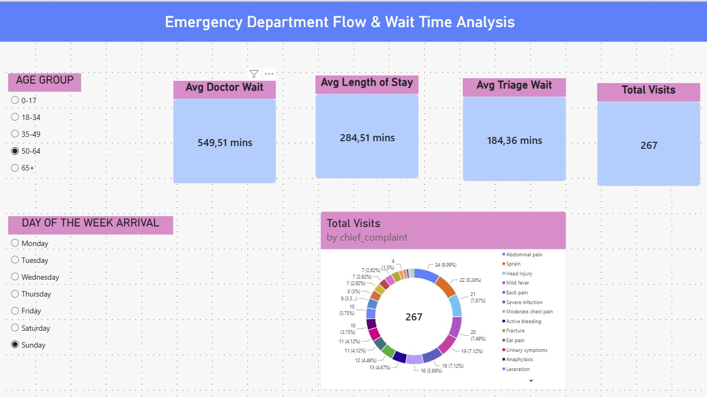

# 🏥 Emergency Department Patient Flow & Operational Analytics

---

## 1. ⚡ Executive Summary (30-Second Read)
This end-to-end healthcare analytics project evaluates patient flow, bottleneck risks, and care delivery efficiency within an Emergency Department (ED). By processing **10,000 patient records** through a custom **Python (Pandas)** ETL pipeline and an interactive **Power BI** dashboard, this solution identifies operational delay drivers and translates raw clinical data into strategic capacity planning insights.

**Key Outcome:** Pinpointed peak arrival windows and triage priority delays, establishing data-driven benchmarks to optimize physician shift allocation and reduce triage-to-doctor wait times.

---

## 2. 🎯 Business Problem & Context
Emergency Departments operate under unpredictable volume surges and strict clinical timelines. Extended wait times lead to increased patient dissatisfaction, higher rates of left-without-being-seen (LWBS) events, and operational strain on staff.

**Core Objective:** 
Hospital administration needed a centralized analytical tool to:
- Monitor key performance indicators (**KPIs**) across triage levels and wait times.
- Understand peak patient volume patterns by hour and day.
- Align medical staffing with actual patient demand to improve care delivery throughput.

---

## 3. 🏗️ Data Architecture & Skills Used
The project follows a structured data pipeline architecture from ingestion to visualization:

[Raw CSV Dataset] ➡️ [Python / Pandas Data Pipeline] ➡️ [Cleaned CSV] ➡️ [Power BI Data Model & DAX] ➡️ [Executive Dashboard]

* **Data Processing & Cleaning:** Python (`pandas`, `numpy`) in VS Code
* **Data Modeling & Transformation:** Power Query, DAX (Data Analysis Expressions)
* **Data Visualization:** Power BI Desktop (Interactive Dashboards, Custom Canvas Layout)
* **Version Control & Hosting:** GitHub

---

## 4. 🔄 Methodology & Data Pipeline

### **Step 1: Data Ingestion & Validation (Python)**
- Loaded raw dataset of 10,000 anonymized patient records.
- Conducted duplicate checks and schema validation.
- Standardized missing values and formatted datetime features.

### **Step 2: Feature Engineering & Sorting**
- **Arrival Time Features:** Extracted `arrival_hour` and `arrival_dayofweek` to analyze volume trends.
- **Sorting Logic:** Built custom `Day Index` logic via Power Query conditional columns to resolve DAX circular dependencies and ensure correct chronological sorting (Monday–Sunday).

### **Step 3: Analytical Measures (DAX)**
Created key DAX measures for operational tracking:
- **Total Patient Visits:** `10,000`
- **Avg Triage Wait Time (Min):** Time elapsed from arrival to initial triage.
- **Avg Doctor Wait Time (Min):** Time elapsed from triage assessment to physician consultation.
- **Avg Length of Stay (LoS):** Total ED turnaround time.

---

## 5. 📊 Key Results & Dashboard Highlights

### **Dashboard Visual Layout:**
- **4 KPI Cards:** Total Visits, Avg Triage Wait Time, Avg Doctor Wait Time, Avg Length of Stay.
- **2 Interactive Slicers:** Dynamic filtering by `Age Group` and `Day of Week`.
- **Primary Visuals:** 
  - **Donut Chart:** Distribution of Chief Complaints / Triage Priority breakdown.
  - **Line Charts:** Hourly arrival patterns and daily volume trends.

### **Key Analytical Findings:**
1. **Peak Demand Surge:** Patient arrivals peak heavily between **14:00 and 18:00**, creating care delivery bottlenecks at triage.
2. **Clinical Urgency Alignment:** Triage Levels 1 & 2 consistently maintain shorter doctor wait times, proving clinical prioritization is effective, though lower-urgency cases face extended delays during afternoon shifts.

---

## 6. 💡 Business Recommendations
Based on the analytical findings, the following action plan is recommended for hospital management:

1. **Dynamic Staff Shift Allocation:** Re-align nursing and physician shift schedules to align with the **14:00 – 18:00 peak volume window**, adding flexible coverage to handle arrival spikes.
2. **Fast-Track Protocol for Low-Acuity Cases:** Implement a dedicated "Fast-Track" lane during afternoon hours for low-urgency patients (Levels 4 & 5) to decrease overall ED Length of Stay (LoS).
3. **Real-time Queue Monitoring:** Integrate automated alerting when average triage wait times cross critical thresholds (>20 mins) to enable proactive resource re-allocation.

---

## 7. 🚀 Next Steps & Future Improvements
- **Predictive Analytics:** Train a Machine Learning regression model (Scikit-Learn) to forecast daily ED volume 24 hours in advance.
- **Database Integration:** Transition from CSV files to a dynamic **PostgreSQL** database pipeline with automated ETL jobs.
- **Expanded Patient Metrics:** Incorporate bed utilization rates, discharge disposition, an
